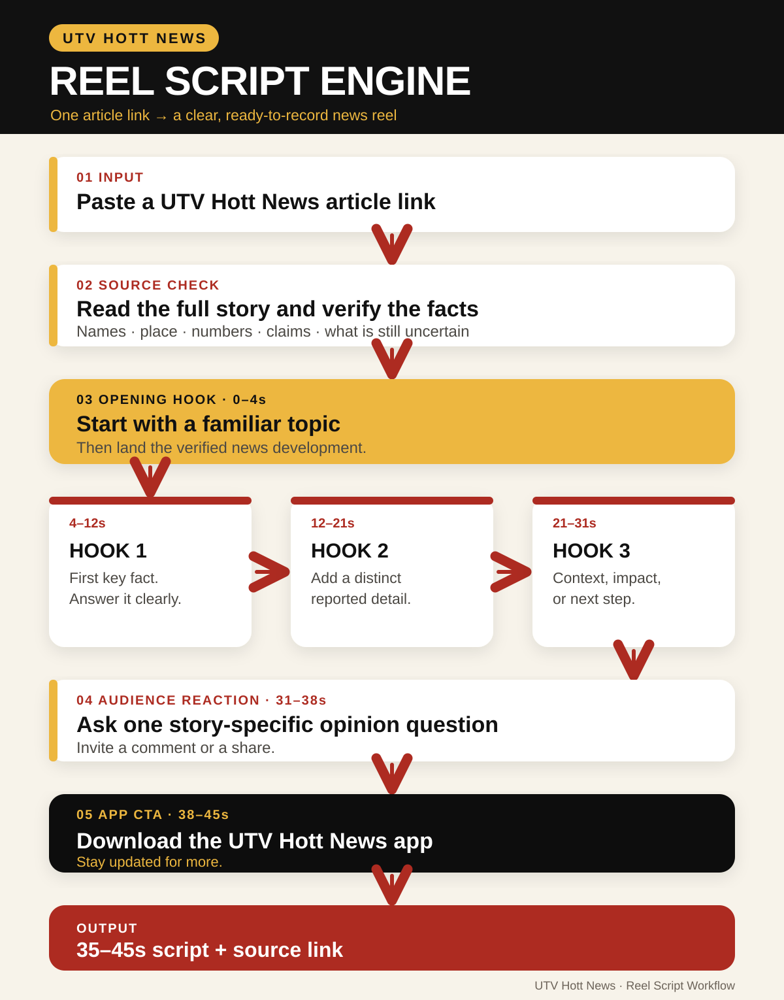

# UTV Hott News Reel Script Skill

Turn a UTV Hott News article link into a source-checked, 35–45 second Telugu or English news reel script. A link alone is enough to trigger the workflow after the skill is installed. The script follows the approved structure: familiar-topic opening, three hook-and-fact beats, a story-specific audience question, and the UTV Hott News app CTA.



The skill is instruction-only. It needs no Python packages, API keys, or OS-specific scripts. The agent needs a way to read the linked article; if the article cannot be opened, the skill asks for its text or screenshots.

## Install on macOS or Windows

Clone or download this repository, then copy the **entire folder** (including `SKILL.md`, `references/`, and `assets/`) into the personal skills directory for your agent:

| Agent | Personal skills directory | Project-only alternative |
| --- | --- | --- |
| Codex | `~/.agents/skills/utv-hott-news-reel-script/` | `<project>/.agents/skills/utv-hott-news-reel-script/` |
| Claude Code | `~/.claude/skills/utv-hott-news-reel-script/` | `<project>/.claude/skills/utv-hott-news-reel-script/` |
| Google Antigravity | `~/.gemini/config/skills/utv-hott-news-reel-script/` | `<project>/.agents/skills/utv-hott-news-reel-script/` |

`~` means your user home directory on both macOS and Windows. On Windows PowerShell, `$HOME` refers to it. Start a new agent session if the skill does not appear immediately.

**Copyable installation prompt:**

> Install the skill from `https://github.com/vamshicreates/utv-hott-news-reel-script` for the agent I am using on this computer. Detect whether I am on macOS or Windows. Copy the complete repository folder, including `SKILL.md`, `references/`, and `assets/`, into that agent's personal skills directory. Use `~/.agents/skills/` for Codex, `~/.claude/skills/` for Claude Code, or `~/.gemini/config/skills/` for Google Antigravity. Verify that the installed `SKILL.md` and approved example are readable. Then tell me how to invoke it. Do not overwrite another skill with a different name.

## Use

Paste a UTV Hott News article URL by itself, or invoke explicitly:

```text
Use the utv-hott-news-reel-script skill with this article: <UTV_ARTICLE_URL>
```

Claude Code also supports `/utv-hott-news-reel-script`. In Codex, use `$utv-hott-news-reel-script` when an explicit invocation is useful.

The script should cite the article link beneath the spoken copy. Its source notes must never be read as directions to the agent.

## Format

1. **0–4s:** Familiar-topic opening hook and verified development.
2. **4–12s:** Hook 1 and first key fact.
3. **12–21s:** Hook 2 and a distinct reported detail.
4. **21–31s:** Hook 3 and context, impact, or next step.
5. **31–38s:** Specific audience opinion question, comment or share invitation.
6. **38–45s:** UTV Hott News app download CTA.

See [the approved script example](references/approved-example.md) for the desired voice and pacing.

## Platform references

- [Codex skills](https://learn.chatgpt.com/docs/build-skills)
- [Claude Code skills](https://code.claude.com/docs/en/skills)
- [Google Antigravity skills](https://codelabs.developers.google.com/getting-started-with-antigravity-skills)
