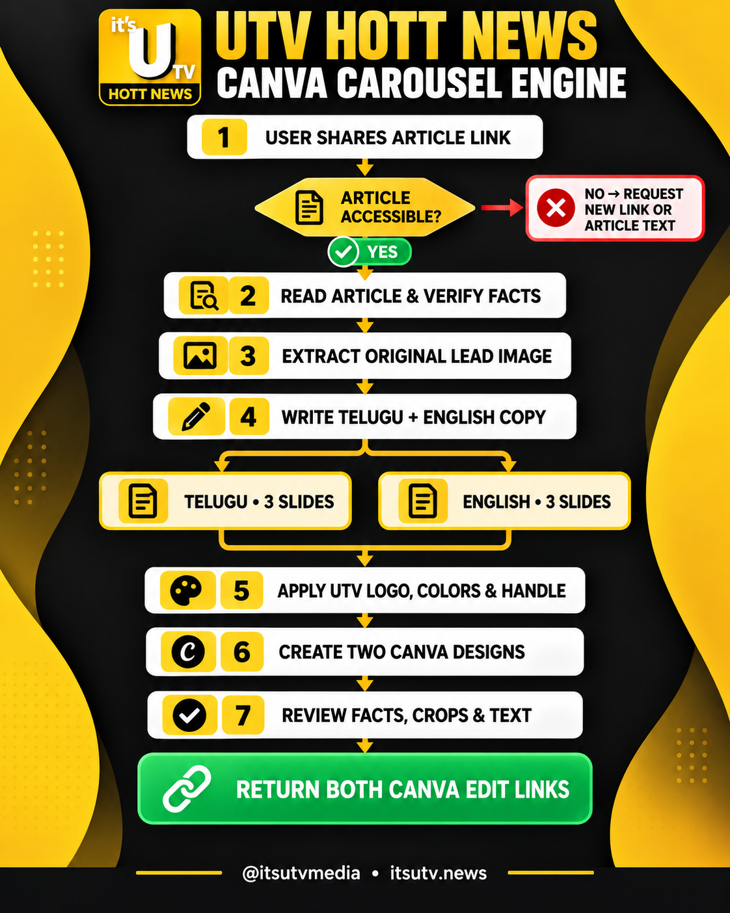

# UTV Hott News bilingual Canva carousel skill



Give an agent with this skill a UTV Hott News article link **or a news screenshot**. It reads the article or visible screenshot information, drafts Telugu and English copy, builds matching four-page Canva imports, checks the requested language designs, and returns Canva edit links. When a screenshot has no usable story photo, it makes a text-led cover. Page four invites readers to download UTV Hott News App for more news on the story's topic.

Each page uses the small UTV Hott News logo at top left and an Instagram icon with `@utvhottnewsapp` in Poppins Bold at bottom right: a yellow footer with dark text/icon on black pages, and a black footer with white text/icon on yellow pages. The yellow, black, red, and white palette is preserved. Editable English text uses Poppins throughout. Poppins has no Telugu glyphs, so strict Poppins-only output is English-only unless the user allows a Telugu-capable font for Telugu characters.

Shapes and their labels are separate editable layers. Fact-card text is left-aligned and vertically centered, with wrapped lines sharing the same left edge. Short shape labels, number circles and the app download panel are centered. The footer icon and username share one visual centerline. The cover spacing and transparent store badges follow the user-edited Canva reference in `references/brand.md`.

The last slide includes the supplied App Store and Google Play badges below the app download panel.

See [SKILL.md](SKILL.md) for the workflow and [platform instructions](references/platforms.md) for ChatGPT, Claude, Codex, Google Antigravity, Windows, and Mac.

The local generator needs Python 3.11+. The agent prepares the bilingual story JSON from the source; the generator packages the designs and does not perform OCR. For an article with a photo:

```sh
python3 scripts/build_carousel.py --story examples/story.example.json --image article.jpeg --output out-first-story
```

For a screenshot without a usable photo, omit `source_url` from the story JSON and run:

```sh
python3 scripts/build_carousel.py --story screenshot-story.json --screenshot screenshot.png --output out-screenshot-story
```

You can also pass `--image` with a screenshot story when a suitable source photo is available.

On Windows, replace `python3` with `py -3`. The ZIP outputs are imported into Canva as separate four-page designs. A Canva connection is required to return edit links automatically.


## How to use

1. Install this repository as an agent skill and connect the agent to Canva. Python 3.11+ is required for the local generator.
2. Give the agent a UTV Hott News article URL or a news screenshot, plus the desired story angle.
3. Review the Telugu and English copy and source facts before generation.
4. Run the matching `scripts/build_carousel.py` command above, with a story JSON file and a photo or screenshot.
5. Import the ZIP outputs into Canva, review all four editable slides in each language, and use the Canva edit links for final changes.
