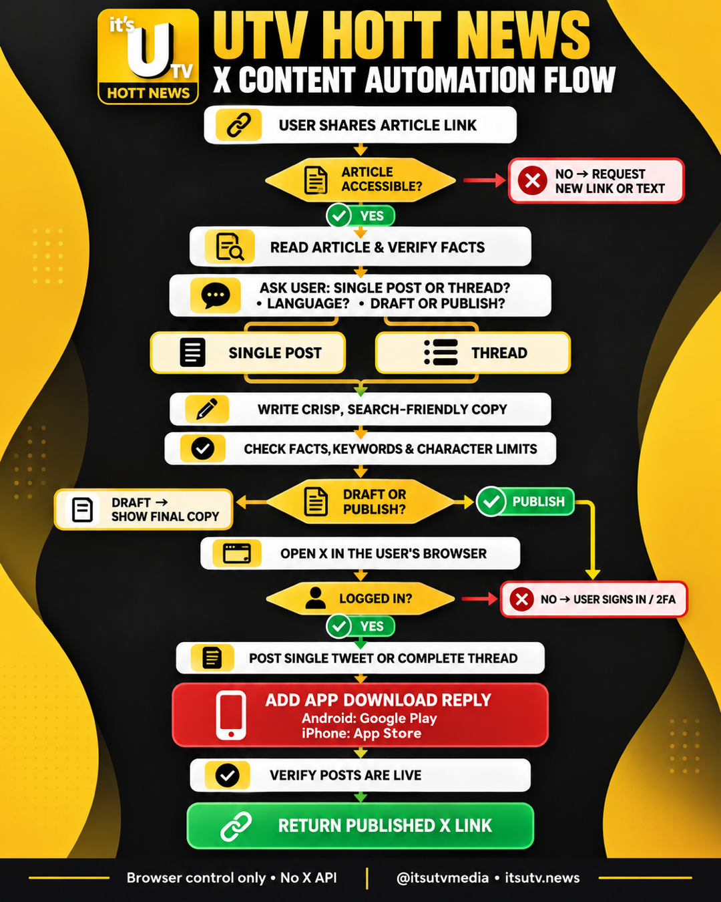

# UTV Hott News X Publisher

Turn an article link into a precise single X post or thread, then optionally publish it through the user's browser. The workflow uses computer control only: no X API, developer account, API key, or OAuth implementation.

## What it does

1. Reads and verifies the supplied article.
2. Asks for single post or thread, English or Telugu, and draft or publish.
3. Produces concise, search-friendly news copy.
4. Publishes through the visible X browser interface when requested.
5. Adds the required UTV Hott News Android and iPhone download reply.
6. Verifies the live conversation and returns its X link.



## Install

Copy the `utv-hott-news-x` folder into the skill directory used by your agent:

- Codex: `~/.codex/skills/`
- Claude Code: `<project>/.claude/skills/` or `~/.claude/skills/`
- Gemini / Antigravity: `<project>/.agents/skills/` or `~/.gemini/config/skills/`
- ChatGPT: upload the folder or a ZIP where custom skills are supported

The same folder works on Windows and macOS. Browser publishing requires a host agent with computer-use or browser-control access and a user-authenticated X browser session.

## Invoke

```text
Use $utv-hott-news-x with this article: <ARTICLE_URL>
```

If preferences are omitted, the skill asks for the format, language, and whether to draft or publish.

## Offline validation

The optional validator uses Python 3.9+ and makes no network requests:

```text
python3 scripts/validate_posts.py draft.json
```

On Windows, use `py -3` instead of `python3`. The live X composer remains the final authority for its character counter.

The required JSON fields and an example are documented in [`references/draft-schema.md`](references/draft-schema.md).
